<<<<<<< HEAD
# Внешняя торговля Беларуси: анализ экспорта и импорта важнейших видов продукции (2000–2021)

Тестовое задание на позицию «Специалист по анализу данных», **Задание 1**.
Данные: Белстат, «Экспорт важнейших видов продукции» и «Импорт важнейших видов продукции» (годовые ряды 2000–2021).
Инструменты: Python (pandas, numpy, scipy, scikit-learn, matplotlib, seaborn). BI-инструменты не использовались.

**Что сделано:** загрузка и очистка данных → контроль качества → 13 графиков и диаграмм → поиск зависимостей и аномалий со статистической проверкой → выводы.

---

## Содержание

- [Структура репозитория](#структура-репозитория)
- [Данные и их особенности](#данные-и-их-особенности)
- [Методология](#методология)
- [Результаты](#результаты)
  1. [Кто растёт быстрее всех](#1-кто-растёт-быстрее-всех)
  2. [Динамика по позициям](#2-динамика-по-позициям)
  3. [Годовые темпы роста: тепловая карта](#3-годовые-темпы-роста-тепловая-карта)
  4. [Синхронность: импорт хрупкий, экспорт устойчивый](#4-синхронность-импорт-хрупкий-экспорт-устойчивый)
  5. [Режимы роста по периодам](#5-режимы-роста-по-периодам)
  6. [Рост против нестабильности](#6-рост-против-нестабильности)
  7. [Экспорт и импорт одной позиции](#7-экспорт-и-импорт-одной-позиции)
  8. [Зависимости между позициями](#8-зависимости-между-позициями)
  9. [Ложная корреляция: корма и мясомолочный экспорт](#9-ложная-корреляция-корма-и-мясомолочный-экспорт)
  10. [Аномалии](#10-аномалии)
  11. [Структура по массе](#11-структура-по-массе)
- [Итоговые выводы](#итоговые-выводы)
- [Ограничения анализа](#ограничения-анализа)
- [Как воспроизвести](#как-воспроизвести)

---

## Структура репозитория

```
.
├── README.md                  # этот отчёт: методология, графики, выводы
├── requirements.txt
├── data/
│   ├── raw/                   # исходные xlsx Белстата (без изменений)
│   └── processed/trade_tidy.csv   # очищенные данные в длинном формате
├── src/load_data.py           # парсинг и очистка xlsx
├── notebooks/
│   ├── analysis.ipynb         # весь анализ с выводами (уже выполнен)
│   └── analysis.py            # тот же ноутбук в формате py:percent (для diff и запуска)
├── figures/                   # 13 графиков (png)
└── results/                   # таблицы: сводка, аномалии, корреляции, структура по массе
```

## Данные и их особенности

Два файла: экспорт (**19 позиций**) и импорт (**13 позиций**), 22 года (2000–2021). Это *важнейшие* позиции, а не вся внешняя торговля.

Что пришлось учесть при обработке:

| Проблема | Решение |
|---|---|
| 106 числовых ячеек (≈15%) хранятся как текст: `'1 196,8'` (40 в экспорте, 66 в импорте) | Нормализация: удаление неразрывных пробелов, замена запятой на точку |
| Единица измерения «зашита» в название товара | Разбор по последней запятой |
| **Разные единицы** по позициям: тыс. т, тыс. шт., тыс. м³, тонны, млн долл. США | Позиции не суммируются; сравниваются темпы и индексы. Исключение — блок «структура по массе» (только тыс. т) |
| Экспорт легковых авто в **штуках**, импорт в **тыс. шт.** | Приведено к тыс. шт. |
| «Мебель» в экспорте — это **стоимость** (млн долл.), а не объём | Помечена; в выводах учитывается, что рост частично ценовой |
| Значения 2019 г. по говядине (140,165447) и мясу птицы (170,371655) имеют лишние знаки | Оставлены как есть, на выводы не влияет |
| Общих позиций в экспорте и импорте всего 4 | Прямое сравнение только по ним (лекарства, чёрные металлы, автозапчасти, легковые авто) |

Пропусков в данных нет.

## Методология

| Задача | Метод | Почему |
|---|---|---|
| Рост | CAGR 2000–2021, 2008–2021 и по подпериодам (2000–08, 2008–14, 2014–21) | Единый показатель, не зависящий от единицы измерения |
| Значимость тренда | Тау Кендалла (непараметрический тест монотонности) | Устойчив к выбросам, не требует нормальности |
| Волатильность | σ годовых лог-темпов ln(x_t / x_{t−1}) | Симметрична для роста и падения |
| Синхронность | Доля позиций с падением за год; медианный темп; PCA по стандартизованным (винзоризованным) лог-темпам | Отделяет общие шоки от товарных |
| Зависимости | Корреляция Спирмена **по темпам роста**, не по уровням; поправка Бенджамини–Хохберга (FDR) | Уровни трендовых рядов коррелируют «сами по себе»; из 496 пар 5% будут «значимыми» случайно |
| Аномалии | Модифицированный z-score по MAD для лог-темпов, порог \|z\| > 3,5 (Иглевич–Хоаглин); отдельная пометка «низкая база» (предыдущее значение < 10% медианы ряда) | Устойчив к выбросам; отсекает «тысячи процентов роста» с нулевой базы |
| Структура | Стековые площади и доли по массе только для позиций в тыс. т | Корректно складывать можно лишь одинаковые единицы |

Полная расшифровка с кодом — в [`notebooks/analysis.ipynb`](notebooks/analysis.ipynb).

---

## Результаты

### 1. Кто растёт быстрее всех

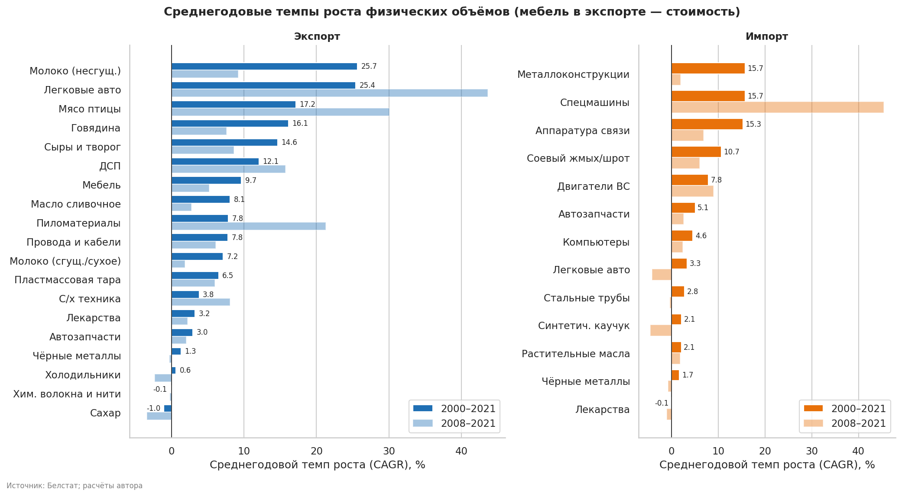

**Экспорт.** Лидеры по CAGR 2000–2021: молоко несгущённое (+25,7% в год, но с очень низкой базы: 1,7 тыс. т в 2000 г.), легковые автомобили (+25,4%, особый случай, см. [аномалии](#10-аномалии)), мясо птицы (+17,2%), говядина (+16,1%), сыры и творог (+14,6%), ДСП (+12,1%), мебель (+9,7%).
Лидеры по CAGR 2008–2021 другие: легковые авто (+43,7%), мясо птицы (+30,1%), пиломатериалы (+21,3%), ДСП (+15,7%).
В аутсайдерах сахар (−1,0%), хим. волокна (−0,1%), холодильники (+0,6%), чёрные металлы (+1,3%).

**Импорт.** Быстрее всего росли металлоконструкции (+15,7%), спецмашины (+15,7%), аппаратура связи (+15,3%) и соевый шрот (+10,7%). Лекарства в импорте остались на уровне 2000 г. (−0,1%).

Тренд Кендалла показывает «устойчивый рост» (τ ≥ 0,6, p < 0,01 и не более −15% от пика) у мяса птицы, говядины, сыров, мебели, масла, проводов, сгущённого молока, пластмассовой тары и лекарств в экспорте, а также у аппаратуры связи, соевого шрота, двигателей и автозапчастей в импорте. Полная таблица: [`results/summary_table.csv`](results/summary_table.csv).

### 2. Динамика по позициям

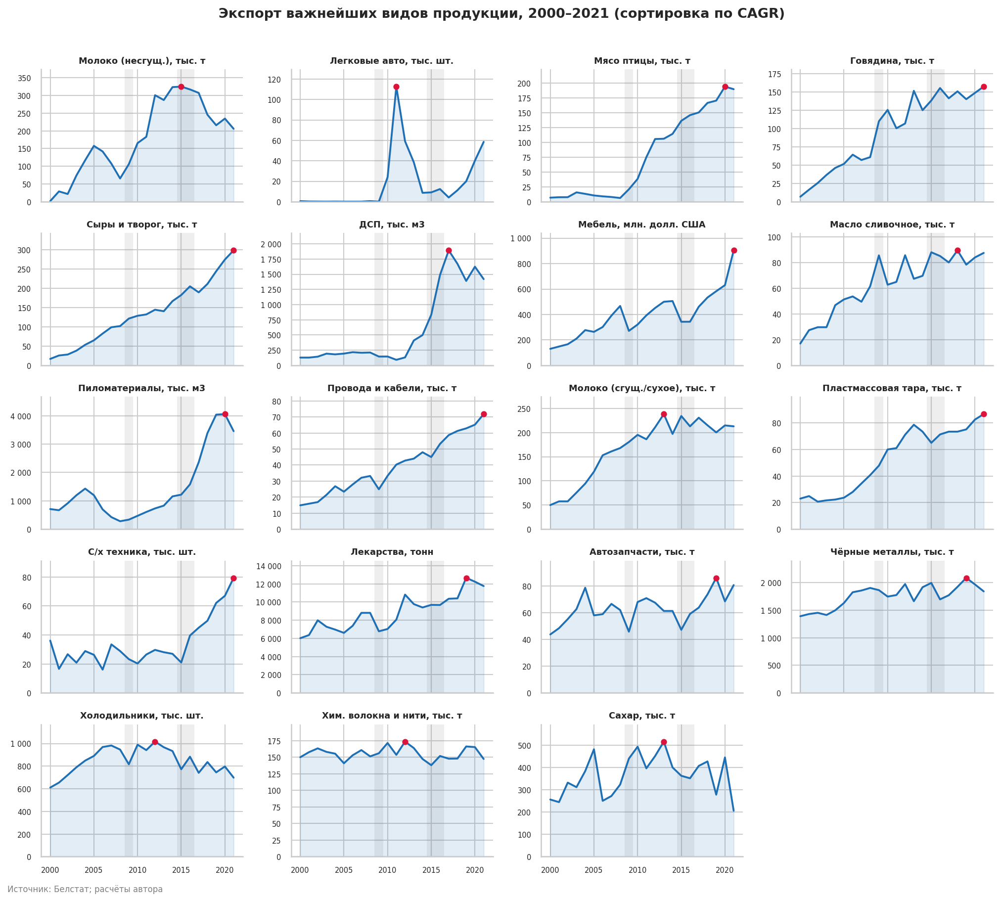

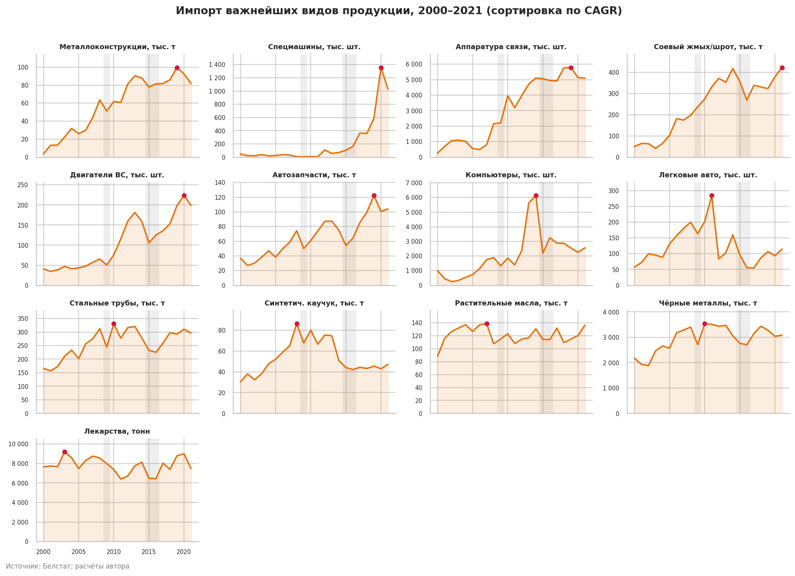

Красная точка — год максимума, серые полосы — 2009 и 2015–2016. Видно три типа траекторий: плавный рост (сыры, провода, тара), «ступени» (мебель, пиломатериалы, спецмашины) и пики с откатом (легковые авто, молоко, компьютеры, ДСП).

### 3. Годовые темпы роста: тепловая карта

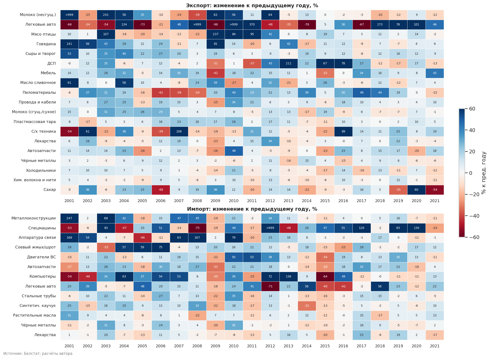

Вертикальные «красные полосы» в импорте (2009, 2011, 2015) показывают, что падали сразу почти все позиции, то есть причина общая, не товарная.

### 4. Синхронность: импорт хрупкий, экспорт устойчивый

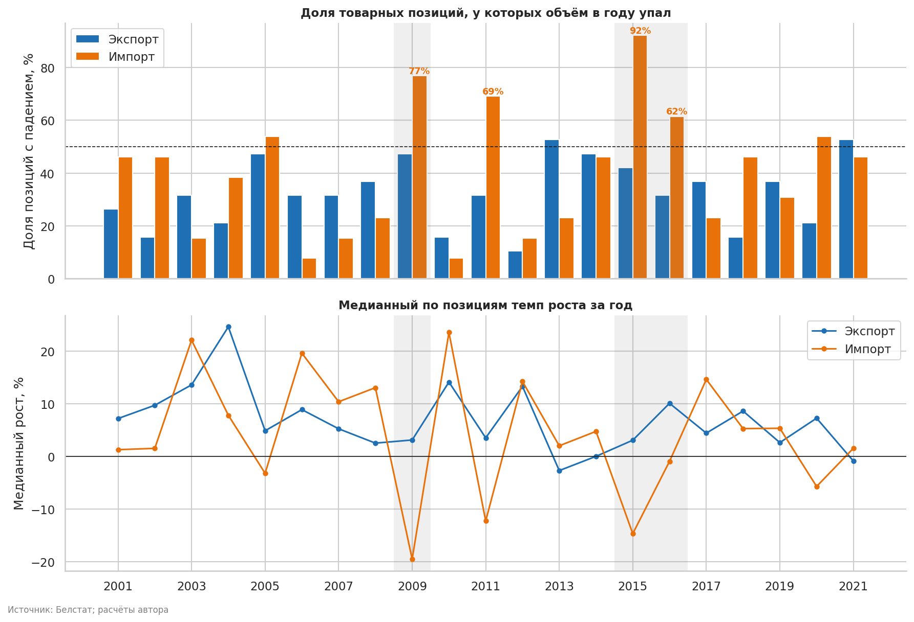

- Доля **импортных** позиций с падением: **2009 — 77%**, **2011 — 69%**, **2015 — 92%** (12 из 13), **2016 — 62%**.
- Для **экспорта** максимум 53% (2013 и 2021), порога 60% не достигнуто ни разу.
- Первая главная компонента темпов роста объясняет **34%** вариации в импорте и **21%** в экспорте: импортом движет общий фактор сильнее, чем экспортом.
- Экспорт в кризис 2009 г. пострадал точечно (мебель −42%, провода и кабели −25%, ДСП −31%), а мясо птицы выросло в 3,4 раза.

Вывод: экспортный набор диверсифицирован и устойчив к общим шокам, импортный — зависит от внутреннего спроса и валютной конъюнктуры.

### 5. Режимы роста по периодам

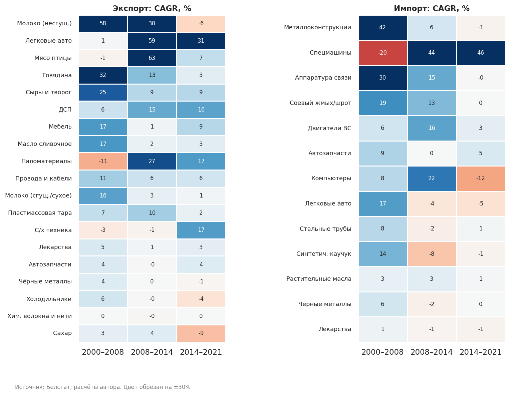

- **2000–2008:** рост экспорта тянул молочно-мясной блок (молоко +58% в год с крошечной базы, говядина +32%, сыры +25%, масло и мебель по +17%). Пиломатериалы (−11%) и мясо птицы (−1%) не росли. В импорте лидировали металлоконструкции (+42%), аппаратура связи (+30%), соевый шрот (+19%).
- **2008–2014:** драйверы экспорта сменились: мясо птицы (+63%), легковые авто (+59%), молоко (+30%), пиломатериалы (+27%), ДСП (+15%). Мебель и автозапчасти встали. В импорте росли спецмашины (+44%), компьютеры (+22%), двигатели (+16%), аппаратура связи (+15%); металл, авто и каучук стагнировали или снижались.
- **2014–2021:** экспорт — ДСП (+16%), пиломатериалы (+17%), с/х техника (+17%), легковые авто (+31%), мебель и сыры (+9%); молоко (−6%), сахар (−9%), холодильники (−4%) сжимались. Импорт почти остановился: у большинства позиций CAGR около нуля, компьютеры −12%; исключение — спецмашины (+46%).

### 6. Рост против нестабильности

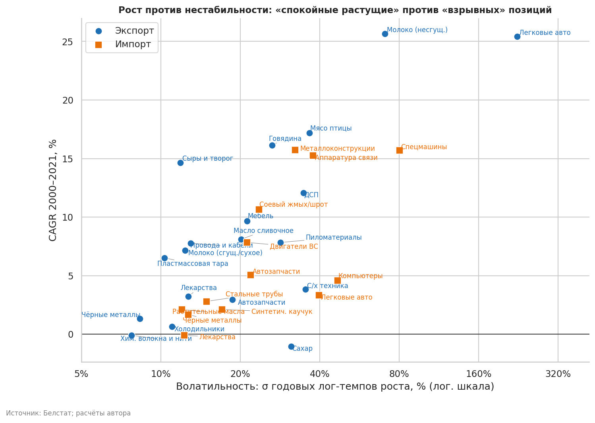

1. **Стабильные «середняки»** (лекарства, чёрные металлы, хим. волокна, растительные масла): CAGR 0–3%, σ < 20%.
2. **Растущие и сравнительно ровные** (мебель, сыры, провода и кабели, пластмассовая тара): CAGR 6–15%, σ 10–21%.
3. **«Взрывные»** (σ > 35%): легковые авто (в экспорте 224%, в импорте 40%), спецмашины (80%), молоко (71%), компьютеры (47%), аппаратура связи (38%), мясо птицы (37%), ДСП и с/х техника (по 35%). Рост ступенями и/или эффект низкой базы.

### 7. Экспорт и импорт одной позиции

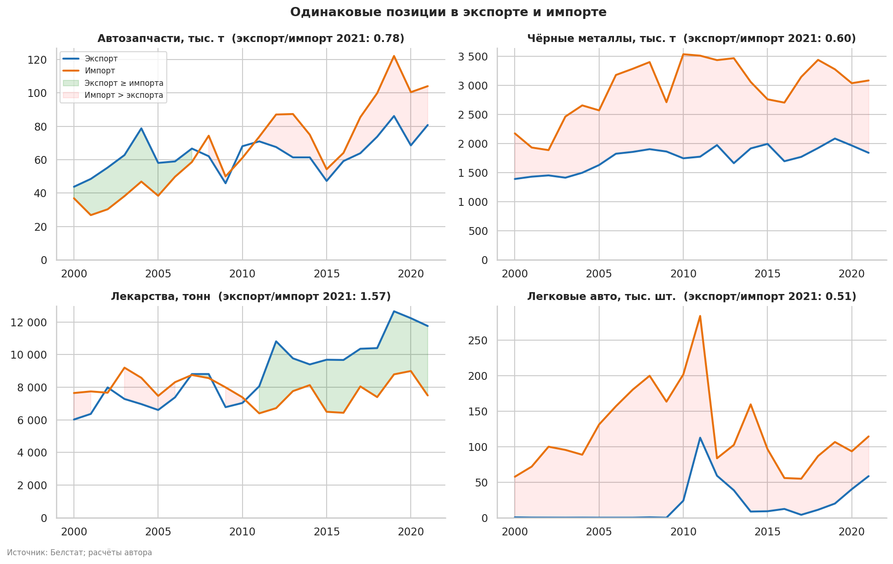

| Позиция | Экспорт/импорт 2021 | Корреляция уровней (Пирсон) | Корреляция темпов (Спирмен) |
|---|---|---|---|
| Автозапчасти | 0,78 | +0,71 | **+0,48 (p = 0,03)** |
| Чёрные металлы | 0,60 | +0,72 | −0,10 (p = 0,65) |
| Лекарства | **1,57** | +0,03 | +0,17 (p = 0,46) |
| Легковые авто | 0,51 | +0,40 | +0,06 (p = 0,79) |

- **Автозапчасти** единственная позиция, где экспорт и импорт движутся вместе и по уровням, и по темпам роста; это согласуется с гипотезой о производственной кооперации (данные её не доказывают).
- **Чёрные металлы:** высокая корреляция уровней (0,72) при нулевой корреляции темпов, то есть эффект общего тренда, а не связь.
- **Лекарства:** экспорт 2021 г. (11,8 тыс. т) в 1,57 раза превышает импорт (7,5 тыс. т). Это тонны, а не доллары: по стоимости картина может быть иной.

### 8. Зависимости между позициями

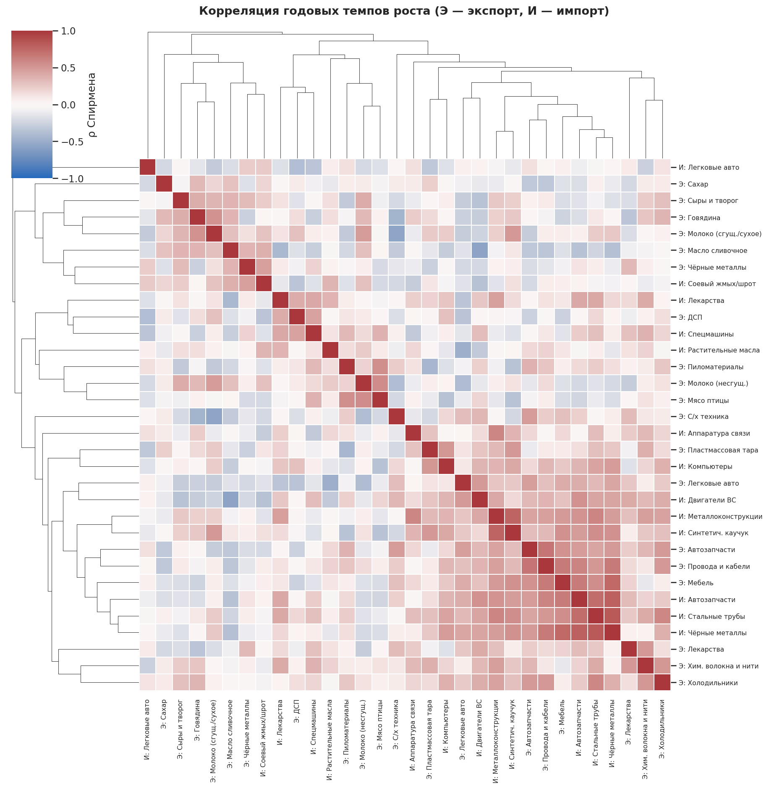

- Проверено **496 пар** рядов; без поправки «значимы» 55 (p < 0,05), хотя случайно ожидалось бы около 25. После поправки Бенджамини–Хохберга при FDR 10% остаются **9 пар**.
- Среди устойчивых связей: трубы ↔ чёрные металлы в импорте (ρ = 0,82), автозапчасти ↔ чёрные металлы (0,79), металлоконструкции ↔ каучук (0,77), экспорт мебели ↔ импорт чёрных металлов (0,75), автозапчасти ↔ трубы (0,72), экспортные автозапчасти ↔ провода и кабели (0,67).
- Кластерограмма показывает **блок синхронных рядов** (экспорт мебели, проводов, автозапчастей и импорт металла, труб, автозапчастей, двигателей): индустриально-инвестиционный цикл, а не отдельные товарные связи. Связь «экспорт мебели ↔ импорт металла» — скорее всего следствие общего цикла, а не причинная.
- Продовольственные позиции (говядина, сыры, молоко, масло) образуют отдельную группу, слабо связанную с промышленным блоком.

### 9. Ложная корреляция: корма и мясомолочный экспорт

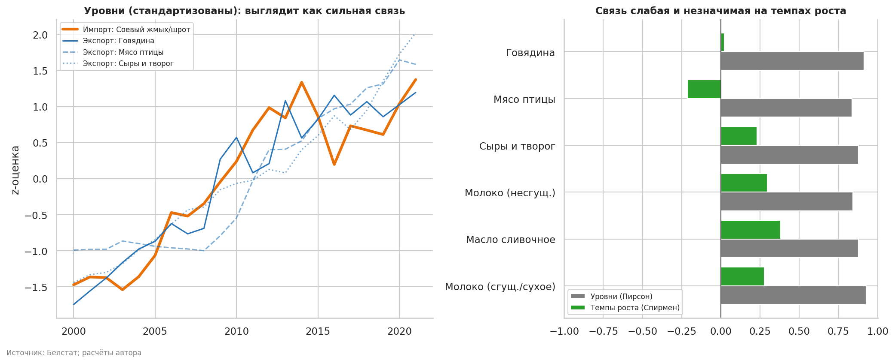

Гипотеза: больше импорт соевого шрота → больше экспорт мяса и молока. По **уровням** корреляция 0,84–0,93, выглядит убедительно. По **темпам роста** она от −0,21 до +0,38 и **ни одна не значима** (все p > 0,08).
Данные не подтверждают краткосрочную связь; наблюдается лишь совпадающий долгосрочный рост. Это пример, почему сравнивать нужно приращения, а не уровни.

### 10. Аномалии

Найдено **28** аномальных годовых изменений (|z| > 3,5), из них **6** — эффект низкой базы. Полный список: [`results/anomalies.csv`](results/anomalies.csv).

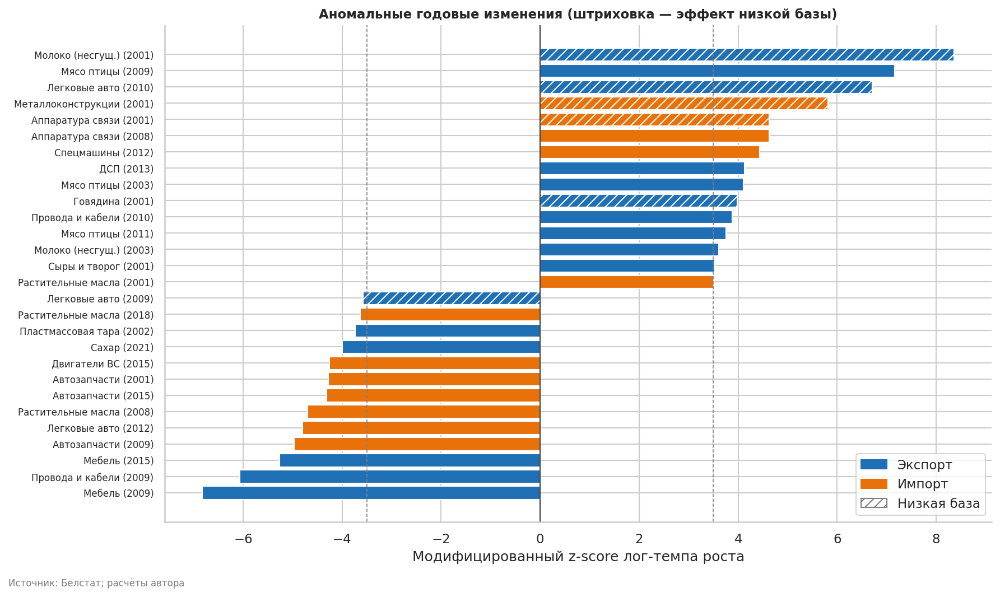

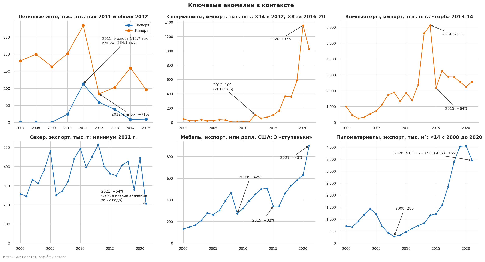

| Что | Что в данных | Интерпретация |
|---|---|---|
| **Легковые авто, 2010–2013** | Экспорт: 0,008 тыс. шт. (2009) → 24,0 → **112,7** (2011) → 59,1 → 38,6. Импорт: 201,8 → **284,1** (2011) → 83,7 (2012, **−71%**) | Экспорт за два года вырос на порядки, а импорт в тот же год достиг пика. Выглядит как реэкспорт ввезённых автомобилей. Причины (валютный кризис 2011 г., изменение таможенных условий) по этим данным не проверить, это гипотеза |
| **Спецмашины (импорт)** | 7,6 тыс. шт. (2011) → 108,9 (2012, ×14) → 1 356 (2020) | Ступенчатый рост, два режима: до 2011 и после; для объяснения нужны данные по подгруппам |
| **Компьютеры (импорт)** | 2 384 (2012) → 5 628 → **6 131** (2014) → 2 193 (2015, **−64%**) | «Горб» 2013–2014 и обвал в 2015 г. по времени совпадает с девальвацией 2014–2015 гг. (причинность по данным не проверить) |
| **Сахар (экспорт), 2021** | 445 → **206** тыс. т (−54%), минимум за 22 года | Ряд колеблется (2018: 427, 2019: 278, 2020: 445, 2021: 206), что типично для урожайных/квотных циклов; без внешних данных причину не установить |
| **Мебель (экспорт)** | 2009: **−42%**, 2015: **−32%**, 2021: **+43%** | Три «ступеньки»; ряд в долларах, значит часть изменений ценовая и валютная |
| **Пиломатериалы (экспорт)** | 280 тыс. м³ (2008) → 4 057 (2020), ×14; 2021: −15% | Самый резкий структурный сдвиг в экспорте |
| **Мясо птицы, 2009** | 6,2 → 20,9 тыс. т (+237%) | Самый резкий рост среди экспортных позиций в кризисный год; причины по данным не установить |
| **Низкая база 2001–2003** | Молоко ×17 (2001), металлоконструкции ×3,5, аппаратура связи ×2,7 и др. | Арифметика малой базы, не события |

### 11. Структура по массе

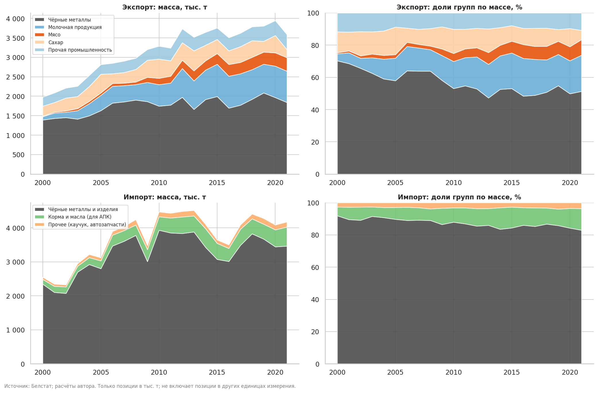

Только позиции в тыс. т. Это структура **по весу**, не по стоимости; тяжёлые товары доминируют.

| Группа | Доля в экспорте, 2000 | Доля в экспорте, 2021 |
|---|---|---|
| Чёрные металлы | 70,3% | **51,4%** |
| Молочная продукция | 4,3% | **22,4%** |
| Мясо (говядина и птица) | 0,7% | **9,7%** |
| Сахар | 13,0% | 5,8% |
| Прочая промышленность | 11,7% | 10,8% |

В импорте по массе: чёрные металлы и изделия 91,9% → 83,0%, сырьё для АПК (масла и соевый шрот) 5,4% → **13,4%**, прочее 2,6% → 3,6%. Рост доли кормов и масел идёт параллельно с ростом экспорта животноводческой продукции (но см. [раздел 9](#9-ложная-корреляция-корма-и-мясомолочный-экспорт): статистической связи по темпам нет).

---

## Итоговые выводы

1. **Экспорт диверсифицирован и устойчив, импорт хрупкий.** Падение сразу 62–92% импортных позиций в 2009, 2011, 2015 и 2016 гг. против максимума 53% в экспорте. Главная компонента темпов роста объясняет 34% вариации импорта и 21% экспорта.
2. **Продовольствие — главный драйвер экспорта до 2015 г.**; после этого молоко (−6% в год) и сахар (−9%) сжимались, масло росло лишь на 3% в год, а сыры, говядина и мясо птицы продолжили расти (CAGR 2014–21: +9%, +3%, +7%). По массе доля молочной продукции в экспорте выросла с 4% до 22%, мяса — с 0,7% до 9,7%.
3. **После 2014 г. появились новые драйверы:** ДСП, пиломатериалы, мебель, с/х техника, провода и кабели. Экспорт пиломатериалов вырос в 14,5 раза с 2008 до 2020 г. и снизился на 15% в 2021 г.
4. **Импорт после 2014 г. почти не растёт** (CAGR около нуля у большинства позиций), единственное заметное исключение — спецмашины.
5. **Аномалии объясняются несколькими причинами:** эффект низкой базы (2001–2003), кризисы 2009 и 2015, реэкспорт автомобилей в 2010–2013, ступенчатый рост спецмашин, резкие колебания сахара. Для части из них нужны внешние данные.
6. **Зависимости:** по уровням почти всё коррелирует (общий тренд), по темпам роста устойчивы лишь 9 из 496 пар, в основном внутри «металлического» блока импорта и в индустриальном цикле. Гипотеза «корма → экспорт мяса и молока» на темпах роста не подтверждается.
7. **Автозапчасти** — единственная позиция, где экспорт и импорт коррелируют и по уровням, и по темпам роста; это согласуется с гипотезой о производственной кооперации.

## Ограничения анализа

- **Только 32 «важнейшие» позиции** в натуральных единицах: нет стоимостных данных и разбивки по странам. Сальдо торговли, ценовые эффекты и структура по партнёрам оценить нельзя.
- Позиции в разных единицах нельзя складывать; структура по массе покрывает только часть позиций (тыс. т) и зависит от веса товаров.
- Всего 21 приращение на ряд: корреляции и тесты имеют низкую мощность; значимость проверена с поправкой на множественные сравнения.
- Причины аномалий (реэкспорт автомобилей, девальвации, урожайные циклы) указаны как **гипотезы**: по этим данным их подтвердить нельзя.
- Экспорт и импорт совпадают лишь по 4 позициям, поэтому сравнение торговых балансов частичное.

## Как воспроизвести

```bash
python -m venv .venv && source .venv/bin/activate   # Windows: .venv\Scripts\activate
pip install -r requirements.txt

# Только очистка данных -> data/processed/trade_tidy.csv
python src/load_data.py

# Весь анализ (создаёт figures/ и results/)
cd notebooks && python analysis.py

# Или в Jupyter
jupyter lab notebooks/analysis.ipynb
```

Протестировано на Python 3.12. Исходные xlsx лежат в `data/raw/`.
=======
# belarus-trade-analysis
>>>>>>> aa05c32432511aad57767b90c8632e81c6a894ef
